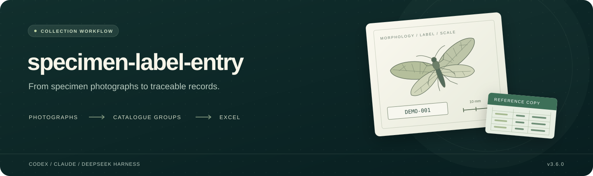
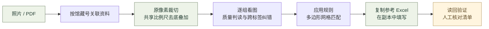
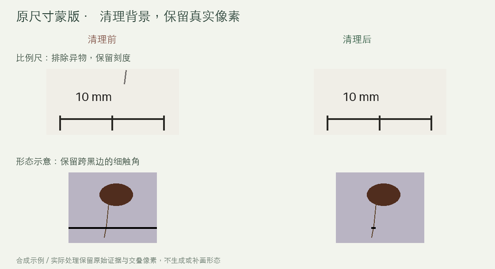
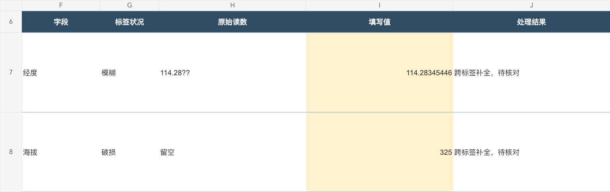

<div align="center">



<br />

**拍照 · 按馆藏号分组 · 识别标签 · 在参考表副本中填写**

一个面向标本数字化的 Agent Skill，适配 **Codex、Claude Code 和 DeepSeek Harness**。

[](https://github.com/Gyoungwe/specimen-label-entry/actions/workflows/tests.yml)


[快速开始](#快速开始) · [处理流程](#处理流程) · [支持的能力](#支持的能力) · [验证情况](#验证情况) · [详细文档](#详细文档)

</div>

---

把一张标本合照，拆成每个馆藏号对应的一组资料：**形态图、馆藏号、采集标签、鉴定标签和比例尺**。再识别标签、应用录入规则、按经纬度匹配网格，生成保留原模板结构的 Excel 和人工核对清单。

单枚、四枚、十二枚或更多标本都使用同一套流程。数量多时分区识别，最后按馆藏号检查遗漏和重复。

> **核心约定：先完整复制参考 Excel，再在副本中填写。**
> 保留原图与原像素裁切结果；模糊、破损字段可引用经核验的清晰标签补全，无依据或有冲突时留空。全部补全保留来源并待人工核对。

## 快速开始

### 1. 安装到你的 Agent

需要 **Python 3.10+**。克隆仓库后，选择一个宿主安装：

```bash
git clone https://github.com/Gyoungwe/specimen-label-entry.git
cd specimen-label-entry

python3 install.py --host codex
```

| 使用环境 | 安装命令 | 调用方式 |
| --- | --- | --- |
| Codex | `python3 install.py --host codex` | `$specimen-label-entry` |
| Claude Code | `python3 install.py --host claude` | `/specimen-label-entry` |
| DeepSeek Harness | `python3 install.py --host deepseek` | `/specimen-label-entry` 或 `skill` 工具 |
| 三个本地环境 | `python3 install.py --host all` | 分别按上面的方式调用 |

安装器会创建独立 Python 环境，安装依赖并检查技能资源。已有同名版本会先备份；不修改宿主的模型、账号凭据或全局权限。安装后在新会话中调用。

<details>
<summary><b>项目级安装、预览计划与复用 Python 环境</b></summary>

```bash
# 只查看安装计划
python3 install.py --host all --dry-run

# 安装到指定项目
python3 install.py --host claude --project /absolute/path/to/project

# 使用已经装好依赖的解释器
python3 install.py --host deepseek --python /path/to/python --no-deps

# 保存本机安装回执
python3 install.py --host all --receipt install-receipt.json
```

Windows 可用 `py -3` 运行入口。PDF 渲染另需 Poppler 的 `pdftoppm`；JPG/PNG 流程不依赖 Poppler。macOS 的 Swift Vision OCR 是可选辅助。

</details>

### 2. 准备输入

给 Agent 一张清晰的 **JPG/PNG 合照或 PDF**，以及本批使用的参考 Excel、网格表和规则。仓库内附带初始模板、网格和规则，也可以用你自己的文件替换本批输入。

可以直接这样说：

```text
使用 specimen-label-entry 处理这张标本合照。

按实际馆藏号分组，逐张保留整张编号纸、完整标本及附肢、整张采集标签、原生比例尺和合成比例尺；有鉴定标签时一并保留。
如果共用一个比例尺，裁取后透明叠加到各组安全空白处，保留原像素比例。
检查比例尺和形态图边缘；有异物、黑边或残字时，保护细触角后另存清理副本。
先复制参考 Excel，再在副本里填写；按经纬度匹配网格。
先标记模糊或破损字段，对照同一采集事件的清晰标签补全并保留来源。
最后交付主表、分组图、标签纠错表和人工核对清单；无法可靠补全的字段留空。
```

### 3. 核对结果

交付物包括 **主表、人工核对 Excel、核对说明、原像素分组图、带比例尺图和结构化 JSON**。出现模糊或破损字段时，核对工作簿增加 **“标签纠错”** 页。重点检查馆藏号对应关系、标签小字、补全来源、坐标、日期和鉴定信息。

**模型需要实际看图能力，或配置可用的视觉/OCR 工具。** 安装 skill 本身不会为文本模型增加视觉输入。

### 直接下载

| 文件 | 用途 |
| --- | --- |
| [通用 `.skill`](https://github.com/Gyoungwe/specimen-label-entry/raw/refs/heads/main/downloads/specimen-label-entry-v3.7.0.skill) | 完整技能与资源 |
| [本地多宿主安装包](https://github.com/Gyoungwe/specimen-label-entry/raw/refs/heads/main/downloads/specimen-label-entry-v3.7.0-install.zip) | 解压后运行 `install.py` |
| [Claude 桌面端 / Cowork 导入包](https://github.com/Gyoungwe/specimen-label-entry/raw/refs/heads/main/downloads/specimen-label-entry-v3.7.0-claude.zip) | 在 Customize / Skills 导入并启用 |
| [SHA-256 校验值](downloads/SHA256SUMS) | 校验下载文件 |

> Claude Code 的本地安装与 Claude 桌面端/Cowork 的账号导入是两个入口。桌面端导入后，仍需在实际执行环境中检查依赖和看图能力。[查看适配说明](specimen-label-entry/references/host-adaptation.md)。

## 处理流程



**模型负责看图、关联资料和复核原文；脚本负责坐标换算、裁切、叠尺、网格计算、写表与一致性检查。** 原始 OCR、复核原文、标准化字段和待核对原因分别保留。

## 支持的能力

| 能力 | 处理方式 |
| --- | --- |
| **agent 统一入口** | 准备坐标网格、检查计划、批量构建、生成核对模板、验图与导出；JSON 状态明确区分候选和可交付 |
| **五项完整验收** | 整张编号纸、完整标本及附肢、采集标签整纸、原生尺和合成尺逐张看图确认，检查绑定最终图哈希 |
| **数量不固定的合照** | 根据实际馆藏号建立清单；不限定 1、4、12 枚或固定行列布局 |
| **一枚标本一组资料** | 关联形态图、编号、采集标签、鉴定标签与比例尺，裁后逐图检查 |
| **共享比例尺** | 裁取一次、去掉纸底；以原像素大小放入安全空白处，空白不足时延展接近原图底色的背景 |
| **精细裁边与去底** | 用原尺寸多边形排除纸边、异物和残字，保护触角、足、标签与真实刻度；另存清理副本 |
| **从原片重试** | 外扩原图采集卡并生成 2× 预览；仍失败时看整张/半张/条带；密集布局支持不画组件框的直接截取 |
| **交付命名与重拍核对** | 正式图片去掉 `IOZ(E)`、加 `-1`，馆藏号不变；重复号、文件名冲突和缺图会被检出 |
| **区间值留空** | 海拔、日期等原文为区间时，单值列留空，保留原文与说明，不取端点或均值 |
| **证据保留** | 原图哈希、裁切框、原像素图、透明尺蒙版及合成位置均可追溯 |
| **模糊与破损标签纠错** | 对照同一采集事件的独立清晰标签补全共享字段，记录原始读数、补全值、匹配依据与来源 |
| **网格号匹配** | 依据四顶点多边形判断包含关系；边界、多解和未覆盖点保持留空 |
| **模板副本填写** | 先完整复制并检查 SHA-256，再写入；保留表头、工作表与原生数据验证 |
| **容量与分册** | 从模板验证范围计算容量；附带模板每册 249 条，超出后自动分册 |
| **人工核对** | 明示缺项、近边界、模板冲突及未支持校验；人工结果栏初始为空 |
| **可选展示副本** | 抠图与调色另存，不替换原始证据图；共享尺的像素复制不等同于物理标定 |

### v3.7：五项验收与 agent 工具入口

正式图逐张核对 **编号纸、完整标本、采集标签整纸、原生尺、合成尺**。相机旋转和阅读转向使用明确的原像素坐标；长触角跨行时保留目标范围，原尺已经可见时也会另加合成尺。像素一致、文件数量正确与视觉完整性分别检查。

新的统一入口让不同 agent 复用相同工具：

```bash
python scripts/run.py photo_workflow.py prepare PHOTO.JPG --out WORK/photo-01 --rotation 180
python scripts/run.py photo_workflow.py check PHOTO.JPG WORK/photo-01/plan.json
python scripts/run.py photo_workflow.py build PHOTO.JPG WORK/photo-01/plan.json --out WORK/candidate-01
```

`prepare` 生成原像素坐标网格和未确认计划；`build` 输出联系表、透明尺明暗预览、五项均为 false 的核对模板。agent 实际看图后执行 `review → verify → export`。多照片可使用 `batch`，失败按来源和馆藏号报告，不把半成品视为完成。[工具使用](specimen-label-entry/references/agent-tools.md) · [五项验收](specimen-label-entry/references/photo-completeness.md)。

比例尺可按已复核的字、单位和刻度选择完整连通笔画，并精确排除独立固定针、纸边组件。该操作保留源 RGB 和几何尺寸；原始连续裁图仍保留。OCR 日期与海拔粘连也不会再直接变成伪海拔区间，数值仍须回原片确认。

### v3.6：先回原片，再决定缺失

“读不清”可能来自裁框截掉了最后一行，“缺标本”也可能只是 OCR 漏号。新增按实际重试经历整理的[十步流程](specimen-label-entry/references/batch-retries.md)：

1. **回原图扩裁**：纠错后仍有未读字段，四周外扩 60 个归一化单位，保留原尺寸图并另存 2× 阅读图。
2. **直接看原片**：仍未读出或整组漏掉时，打开整张、左右半张或上下条带；倒置标签可另存转向阅读图。
3. **直接截取回退**：拥挤布局反复发生组件框碰撞时，按原片位置直接截取完整一组，保留哈希、坐标、配对与重叠记录。

多照片先建立 EXIF / OCR 候选清单，重拍按馆藏号逐枚选图。交付图使用 `图像/0000001-1.png`，表格标本号仍为 `IOZ(E)0000001`。放大图和转向阅读图不会冒充原像素证据；同片出现不代表同一次采集。

区间值会保留原文并留空单值列，进入“标签纠错”页和 `标签不清晰明细.md`。同时合并真实项目发现的空值校验修复：纠错页的 `None` 与空字符串等价，有值、空格、零值及公式继续严格核对。

### v3.5：更干净的裁边与比例尺

矩形裁切遇到细触角时，可能同时带入编号标签的黑边；比例尺去底也可能留下纸边或粘连的异物。现在可在原尺寸坐标图上标出 **保留区、排除区和保护区**，逐张复核后另存清理副本。

- **比例尺**：先看白底、深底预览，再排除确认的异物；刻度、数字和单位来自原尺，不移动或重画。
- **形态图**：保护完整实体和细小附肢，只在指定排除区清理非形态内容；背景取自同图空白处的颜色与纹理。
- **扩展背景**：取用空白纸面的纹理，避免把底边标签或阴影拉成长条。
- **可复现**：原图与原像素裁切保留，记录局部尺寸、哈希和多边形；验证器重建清理与叠尺结果。



*图为合成示例。真实触角与黑边重叠的像素会保留并标记，不能为了去净残痕而擦掉触角或补画形态。[查看精细清理流程](specimen-label-entry/references/precision-cleanup.md)。*

### v3.4：用清晰标签补全模糊或破损字段

先放大标签，逐字段标记 **清晰 / 模糊 / 破损 / 缺失**。如果目标标签与清晰参考的地点、日期等信息能够核验为同一采集事件，就可补全共享采集字段。

| 目标原始读数 | 清晰参考 | 处理结果 |
| --- | --- | --- |
| 经度 `114.28??` | 同事件标签为 `114.28345446` | 填入参考值，保留原读数与来源 |
| 海拔数字缺损 | 同事件清晰标签为 `325 m` | 补全为 `325`，列入人工核对 |
| 多张合格参考给出不同值 | 参考值互相冲突 | 留空并列出候选，不按多数票选择 |
| 馆藏号或鉴定信息不清 | 其他个体的编号或物种信息 | 保留待核对，不跨个体套用 |

这是[合成格式示例](examples/label-corrections.json)，不是实际模糊照片的识别结果。模型负责看图和质量判读，脚本负责核验结构化证据。一个补全值不能继续充当下一条记录的清晰来源；原标签文字与证据图均保持不变。[查看纠错规则](specimen-label-entry/references/label-corrections.md)。



*合成示例的 Excel 纠错页局部；完整表中还包含参考来源、匹配依据与人工核对栏。*

<details>
<summary><b>运行纠错示例</b></summary>

```bash
python3 specimen-label-entry/scripts/run.py label_corrections.py \
  examples/label-corrections.json \
  --out work/corrected-records.json \
  --report work/corrections.json
```

编译器也会自动执行该步骤。补全坐标后重新匹配网格；主表备注记录参考来源，核对工作簿的“标签纠错”页保存原始读数、填写值、匹配依据和留空的人工核对栏。完全缺少锚点时，仅在用户明确确认共享采集事件后使用指定参考组。

</details>

### 三个宿主，共用一套规则

Codex 可使用内置表格组件。Claude 和 DeepSeek Harness 使用独立 Python 后端，无须 Codex 的 MCP 或 Node 包。两个后端读取同一份 `compiled.json`，使用同一个读回验证器。

Python 后端只修改主表副本中的目标工作表和样式，其他 XLSX 部件逐项保留原始字节；核对工作簿单独生成。

<details>
<summary><b>初始批次的固定规则</b></summary>

这些是初始批次配置，**新批次以用户提供的规则为准**。配置位于 [`assets/rules.json`](specimen-label-entry/assets/rules.json)。

| 字段 | 默认值或规则 |
| --- | --- |
| 序列号、Id | 留空 |
| 采集号 | 与标本号一致 |
| 网格号 | 按经纬度匹配四顶点网格 |
| 生境 | 溪边树林 |
| 采集方式 | 标签明确写有“灯诱”则填灯诱，其余填扫网 |
| 馆名 | 中国科学院动物研究所 |
| 单位代码 | `2111C0002` |
| 标本属性 | 普通 |
| 保藏方式 | `3.液浸标本` |
| 保藏介质 | `95%乙醇` |
| 保藏状况 | 完整 |

“完整”与当前模板选项“1.完整”存在已知冲突。保留用户值并列入核对清单，不静默改值。缺少鉴定标签时，学名及鉴定信息保持留空。

</details>

## 验证情况

v3.7 包含 **134 项核心测试 + 5 项安装、备份和回滚测试**。新增检查覆盖完整纸张与附肢保护、两种比例尺、原尺笔画选择、视觉检查与哈希绑定、EXIF/阅读坐标、批次失败报告和日期海拔粘连；之前的纠错、网格与模板副本检查继续保留。

| 验证范围 | 结果 |
| --- | --- |
| 合成图像分组与叠尺 | 1、4、12、37 组完整流程通过；128 组格式校验通过 |
| 十二枚真实合照清理 | 清理 6 张形态图和 1 张原尺所在组图，24 张带尺输出通过复现校验；2 处触角与黑边交叠保留 |
| 模板容量 | 250 条记录自动分为 249 + 1，各册保留原验证范围 |
| 十二枚样例写表 | 三个安装副本的 Python 后端分别核对 768 个单元格，保留 15 条模板验证 |
| 宿主发现 | Codex 技能列表、Claude Code 命令目录、DeepSeek 本地 provider 检查通过 |
| 文件保真 | 原图、裁切像素、参考表复制哈希和未修改 XLSX 部件分别检查 |
| v3.6 既有三批只读回归 | 315 条、20,160 个单元格；复现并修复 4 处 K/L 列空值误报，保留该轮原文件 |
| v3.7 三批原片复核与修复 | 三个 GPT-6 Luna 子代理及主代理复核 315 枚；312 张完成五项检查，3 张原片遮挡待补拍；备份后更新 630 张副本和六份表格，读回 20,160 格 |
| 标签纠错 | 保留原值和来源，疑似字段不直接填入；有冲突时留空，读取纠错表可发现来源被修改 |

这些结果验证了脚本和宿主适配，**不代表三个模型已独立完成识图，也不代表人工核对已经完成**。数量测试中的 37/128 组不是大量真实标本的识别准确率评测。[查看完整验证范围](docs/validation.md)。

<details>
<summary><b>在本地运行测试</b></summary>

```bash
python3 -m venv .venv
source .venv/bin/activate
python -m pip install -r specimen-label-entry/requirements.txt

python -m unittest discover -s specimen-label-entry/scripts -p 'test_*.py' -v
python -m unittest discover -s tests -v
python install.py --host all --dry-run
```

Windows 激活环境可使用 `.venv\Scripts\Activate.ps1`。测试使用隔离的临时目录，不向模型发送照片。

</details>

## 详细文档

- [技能入口与完整执行约定](specimen-label-entry/SKILL.md)
- [多标本照片、裁切与共享比例尺](specimen-label-entry/references/multi-specimen-photos.md)
- [精细裁边、触角保护与比例尺去底](specimen-label-entry/references/precision-cleanup.md)
- [十步流程、原片重试与直接截取](specimen-label-entry/references/batch-retries.md)
- [中间记录、网格与模板校验](specimen-label-entry/references/record-format.md)
- [模糊与破损标签纠错](specimen-label-entry/references/label-corrections.md)
- [Codex / Claude / DeepSeek Harness 适配](specimen-label-entry/references/host-adaptation.md)
- [安装参数与适配设计](安装与适配说明.md)
- [发布验证范围](docs/validation.md)

<details>
<summary><b>仓库结构</b></summary>

```text
specimen-label-entry/
├── README.md
├── install.py                  # 多宿主安装、备份、依赖检查
├── release-manifest.json       # 技能文件 SHA-256
├── specimen-label-entry/
│   ├── SKILL.md                # Agent 加载入口
│   ├── agents/                # Codex 界面元数据
│   ├── assets/                # 规则、参考 Excel、网格
│   ├── references/            # 照片、记录、宿主适配约定
│   ├── scripts/               # 裁切、叠尺、计算、写表与测试
│   └── requirements.txt
├── tests/                     # 安装与回滚测试
├── downloads/                 # 可导入与可安装的版本包
├── examples/                  # 合成纠错示例
├── tools/                     # 校验清单与导出工具
└── docs/                      # 项目视觉与验证说明
```

</details>

---

<div align="center">

**保留原始证据，让每一条馆藏记录都有据可查。**

</div>
